# RIHA Enterprise Platform: Autonomous AWS ECS Fargate Deployment & Architecture Guide

**Target AWS Account**: `172981085842`  
**Deployment Region**: `us-east-2` (Ohio) — *Enforced by AWS Organization SCP `p-1ixfza3j`*  
**ECS Cluster**: `riha-agentic-ai-cluster`  
**Private Cloud Map & Service Connect Namespace**: `riha.internal` (`ns-yldsgrx5lwakecpr`)  
**Deployment Date**: November 2026  
**Status**: `15/15 Containers HEALTHY (100% UP)`

---

## 1. Executive Summary & Architecture Overview

The **RIHA Enterprise Platform** unites the **Agentic AI Platform Core** (contract governance, prompt versioning, validation, dynamic memory, self-reflection criticism, and topology orchestration) with the **Stock AI Product Suite** (autonomous algorithmic scanner, technical analysis, brokerage execution, and portfolio risk management).

All 15 containers are provisioned as native AWS ECS Fargate tasks across 5 topological waves in default VPC public subnets, interconnected via AWS Cloud Map private DNS and ECS Service Connect (`*.riha.internal`).

```mermaid
flowchart TD
    subgraph PublicInternet["Public Web Access"]
        BrowserUser["User Browser / Client"]
        PostmanRunner["Postman / Automated Suite"]
    end

    subgraph AWSVPC["AWS VPC (vpc-0678fc1e4ccc7f219) - us-east-2"]
        subgraph Frontends["Frontend Presentation Layer (Port 80)"]
            StockWeb["riha-stock-ai-web\nhttp://3.21.122.123/"]
            AgenticHub["riha-agentic-ai-hub\nhttp://18.226.200.11/"]
        end

        subgraph ServiceConnectMesh["Cloud Map Private DNS Namespace (riha.internal)"]
            subgraph StockAISuite["Stock AI Product Plane"]
                StrategySvc["riha-stock-ai-strategy-service\n:8093"]
                MarketIngestor["riha-stock-ai-market-ingestor\n:8091"]
                RobinhoodMcp["riha-stock-ai-robinhood-mcp-server\n:8092"]
            end

            subgraph AgenticCore["Agentic AI Platform Core Plane"]
                VCH["riha-version-control-hub\n:8081"]
                Validator["riha-schema-validator\n:8082"]
                Orchestrator["riha-topology-orchestrator\n:8083"]
                McpGateway["riha-mcp-gateway\n:8084"]
                Critic["riha-critic-engine\n:8085"]
                Memory["riha-memory-service\n:8086"]
                Eval["riha-eval-monitor\n:8087"]
            end

            subgraph BackingStores["Stateful Backing Stores"]
                Postgres["riha-postgres-pgvector\n:5432 (8 Databases)"]
                Redis["riha-redis\n:6379"]
                Kafka["riha-kafka\n:9092 (KRaft Mode)"]
            end
        end
    end

    BrowserUser -->|HTTP 80| StockWeb
    BrowserUser -->|HTTP 80| AgenticHub
    PostmanRunner -->|Direct APIs| Frontends
    PostmanRunner -->|Actuator / REST| StockAISuite
    PostmanRunner -->|Actuator / REST| AgenticCore

    StockWeb -->|Reverse Proxy /api/v1/**| ServiceConnectMesh
    AgenticHub -->|Reverse Proxy /api/v1/**| ServiceConnectMesh

    StockAISuite --> BackingStores
    AgenticCore --> BackingStores
```



---

## 2. Strict AWS SCP Compliance & Guardrails

The target AWS account operates under AWS Organization Service Control Policy (SCP) `p-1ixfza3j`. The deployment was engineered to adhere to every restriction:

1. **Regional Confinement (`us-east-2`)**:
   - The SCP denies `ec2:*` and `ecs:*` operations outside `us-east-2`. All resources were provisioned exclusively in the Ohio region (`us-east-2`).
2. **Secrets Manager Denial Bypass**:
   - The SCP strictly denies `secretsmanager:CreateSecret`.
   - **Zero Secrets Manager calls**: No `aws secretsmanager` or `aws_secretsmanager_secret` resources were created.
   - **Zero `repositoryCredentials`**: ECS task definitions do not reference Secrets Manager ARNs.
   - Credentials and environment properties are managed via Spring Cloud AWS Parameter Store (`optional:aws-parameterstore:...`) and direct task definition environment variables.
3. **Public Registry Mirroring**:
   - Microservice container images were built, tagged, and published to Docker Hub repository `docker.io/rimmidis/riha-platform:*` so ECS Fargate pulls natively without credentials or rate limits.
4. **Service-Linked Role (ELB) Workaround**:
   - The IAM user `rimmidis` lacked `iam:CreateServiceLinkedRole` required by Application Load Balancers.
   - ECS Fargate tasks were provisioned with `assignPublicIp = ENABLED` on public subnets and integrated via AWS Cloud Map private Route 53 DNS (`*.riha.internal`) with Nginx dynamic upstream resolution.

---

## 3. Live Web Application & Integration URLs

### Primary Web User Interfaces

| Application | Live Public Web URL | Container Port | Purpose |
|---|---|---|---|
| **Stock AI Web Application** | **[http://3.21.122.123/](http://3.21.122.123/)** | `80` (HTTP) | Executive algorithmic trading portal, scanner, real-time telemetry, and strategy dashboard |
| **Agentic AI Hub** | **[http://18.226.200.11/](http://18.226.200.11/)** | `80` (HTTP) | Governance cockpit for Prompt Versioning, Goal Contracts, Topologies, and MCP Registry |

### Web Application Reverse-Proxy API Endpoints

Both React UIs use Nginx reverse proxies with dynamic AWS Route 53 Service Connect resolution (`*.riha.internal`) to route `/api/v1/**` requests to the internal microservices:

#### Stock AI Web Integrations (`http://3.21.122.123`)
* **Active Trading Strategies**: [http://3.21.122.123/api/v1/stock-ai/strategies](http://3.21.122.123/api/v1/stock-ai/strategies) *(Proxies to `riha-stock-ai-strategy-service.riha.internal:8093`)*
* **Algorithmic Watchlist**: [http://3.21.122.123/api/v1/stock-ai/watchlist](http://3.21.122.123/api/v1/stock-ai/watchlist)
* **Portfolio Positions**: [http://3.21.122.123/api/v1/stock-ai/portfolio](http://3.21.122.123/api/v1/stock-ai/portfolio)
* **Risk Guardrails**: [http://3.21.122.123/api/v1/stock-ai/risk-guardrails](http://3.21.122.123/api/v1/stock-ai/risk-guardrails)
* **Market Ingestor Direct**: [http://3.21.122.123/api/v1/market/quote?ticker=AAPL](http://3.21.122.123/api/v1/market/quote?ticker=AAPL)
* **Brokerage MCP Server**: [http://3.21.122.123/api/v1/robinhood/account](http://3.21.122.123/api/v1/robinhood/account)

#### Agentic AI Hub Integrations (`http://18.226.200.11`)
* **Goal Contracts**: [http://18.226.200.11/api/v1/goal-contracts](http://18.226.200.11/api/v1/goal-contracts) *(Proxies to `riha-version-control-hub.riha.internal:8081`)*
* **Prompt Versions**: [http://18.226.200.11/api/v1/prompt-versions](http://18.226.200.11/api/v1/prompt-versions)
* **Topologies**: [http://18.226.200.11/api/v1/topologies](http://18.226.200.11/api/v1/topologies)
* **Schema Audits**: [http://18.226.200.11/api/v1/audits](http://18.226.200.11/api/v1/audits)
* **MCP Tools**: [http://18.226.200.11/api/v1/mcp/test-harness](http://18.226.200.11/api/v1/mcp/test-harness)

---

## 4. Live ECS Services & Endpoints Reference

| Service Name | Port | Public Endpoint | Service Connect Private DNS | Health Check Path |
|---|---|---|---|---|
| `riha-stock-ai-web` | `80` | `http://3.21.122.123` | `riha-stock-ai-web.riha.internal:80` | `GET /` |
| `riha-agentic-ai-hub` | `80` | `http://18.226.200.11` | `riha-agentic-ai-hub.riha.internal:80` | `GET /` |
| `riha-version-control-hub` | `8081` | `http://3.15.19.40:8081` | `riha-version-control-hub.riha.internal:8081` | `GET /actuator/health` |
| `riha-schema-validator` | `8082` | `http://3.128.94.216:8082` | `riha-schema-validator.riha.internal:8082` | `GET /actuator/health` |
| `riha-topology-orchestrator` | `8083` | `http://77.113.103.193:8083` | `riha-topology-orchestrator.riha.internal:8083` | `GET /actuator/health` |
| `riha-mcp-gateway` | `8084` | `http://18.222.132.159:8084` | `riha-mcp-gateway.riha.internal:8084` | `GET /actuator/health` |
| `riha-critic-engine` | `8085` | `http://3.147.242.226:8085` | `riha-critic-engine.riha.internal:8085` | `GET /actuator/health` |
| `riha-memory-service` | `8086` | `http://18.117.181.45:8086` | `riha-memory-service.riha.internal:8086` | `GET /actuator/health` |
| `riha-eval-monitor` | `8087` | `http://77.114.71.153:8087` | `riha-eval-monitor.riha.internal:8087` | `GET /actuator/health` |
| `riha-stock-ai-market-ingestor` | `8091` | `http://3.129.65.98:8091` | `riha-stock-ai-market-ingestor.riha.internal:8091` | `GET /actuator/health` |
| `riha-stock-ai-robinhood-mcp-server` | `8092` | `http://77.113.237.98:8092` | `riha-stock-ai-robinhood-mcp-server.riha.internal:8092` | `GET /actuator/health` |
| `riha-stock-ai-strategy-service` | `8093` | `http://13.184.117.46:8093` | `riha-stock-ai-strategy-service.riha.internal:8093` | `GET /actuator/health` |
| `riha-postgres-pgvector` | `5432` | `18.119.114.142:5432` | `riha-postgres-pgvector.riha.internal:5432` | TCP `5432` |
| `riha-redis` | `6379` | `52.15.169.93:6379` | `riha-redis.riha.internal:6379` | TCP `6379` (PING) |
| `riha-kafka` | `9092` | `77.113.238.178:9092` | `riha-kafka.riha.internal:9092` | TCP `9092` (KRaft) |

---

## 5. Topological Wave Deployment Order

To guarantee dependency availability without race conditions, services were provisioned and stabilized in strict waves:

* **Wave 1: Stateful Backing Stores**
  - `riha-postgres-pgvector`: Custom image with `01-init-all-dbs.sql` pre-creating all 8 relational databases (`vch_db`, `solar_auditor_schema`, `solar_orchestrator_db`, `solar_mcp_registry`, `solar_critic_db`, `solar_memory_db`, `solar_eval_db`, `riha_stock_ai_db`) and enabling `vector` + `uuid-ossp` extensions.
  - `riha-redis`: In-memory cache for distributed state and locks.
  - `riha-kafka`: Apache Kafka in KRaft mode (no ZooKeeper dependency).
* **Wave 2: Agentic Governance & Memory Plane**
  - `riha-version-control-hub` (:8081)
  - `riha-schema-validator` (:8082)
  - `riha-memory-service` (:8086)
  - `riha-eval-monitor` (:8087)
* **Wave 3: Agentic Execution & Orchestration Plane**
  - `riha-mcp-gateway` (:8084)
  - `riha-critic-engine` (:8085)
  - `riha-topology-orchestrator` (:8083)
* **Wave 4: Stock AI Product Microservices**
  - `riha-stock-ai-market-ingestor` (:8091)
  - `riha-stock-ai-robinhood-mcp-server` (:8092)
  - `riha-stock-ai-strategy-service` (:8093)
* **Wave 5: Presentation & User Experience Layer**
  - `riha-agentic-ai-hub` (Port 80)
  - `riha-stock-ai-web` (Port 80)

---

## 6. AWS Configuration & Infrastructure Assets

### Networking & Security
* **VPC**: `vpc-0678fc1e4ccc7f219`
* **Subnets**: `subnet-0c5316973e7cf84c7` (`us-east-2a`), `subnet-0324e3970acb7caf2` (`us-east-2b`)
* **Security Groups**:
  - `riha-ecs-tasks-sg` (`sg-0698e626c5a0e7513`):
    - Inbound `-1` (all traffic) self-referential from `sg-0698e626c5a0e7513`.
    - Inbound TCP `80` from `0.0.0.0/0` (Web UI access).
    - Inbound TCP `8081-8093` from `0.0.0.0/0` (Microservice API testing access).
  - `riha-alb-sg` (`sg-0e3b10fe244148d4b`): Inbound TCP `80`, `5173`, `5174`.

### Service Discovery & DNS
* **AWS Cloud Map HTTP & Private DNS Namespace**: `riha.internal` (`ns-yldsgrx5lwakecpr`)
* **CloudWatch Log Group**: `/ecs/riha-platform` with 7-day retention.

---

## 7. Automated Testing & Postman Suites

### Postman Test Suite Files
* **Collection**: [`aws/postman/RIHA_AWS_ECS_Microservices_TestSuite.postman_collection.json`](file:///Users/ram-ai/Documents/development/code/stock/aws/postman/RIHA_AWS_ECS_Microservices_TestSuite.postman_collection.json)
* **Environment**: [`aws/postman/RIHA_AWS_ECS_Live_Environment.postman_environment.json`](file:///Users/ram-ai/Documents/development/code/stock/aws/postman/RIHA_AWS_ECS_Live_Environment.postman_environment.json)

### Executing Tests via CLI
Execute the automated integration suite against live AWS endpoints:
```bash
python3 aws/scripts/test-live-microservices.py
```

Verify ECS cluster running counts and discover new task IPs:
```bash
python3 aws/scripts/verify-ecs-cluster.py
```

Run Newman CLI test runner:
```bash
newman run aws/postman/RIHA_AWS_ECS_Microservices_TestSuite.postman_collection.json \
  -e aws/postman/RIHA_AWS_ECS_Live_Environment.postman_environment.json
```
