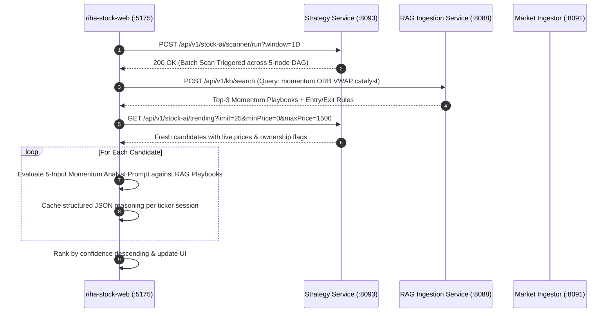

# RIHA Stock AI Microservices Architecture Specification

**Product Identifier**: `RIHA_STOCK_AI`  
**Goal Contract ID**: `RIHA_STOCK_AI_TRADE_CONTRACT_V1`  
**Strategy DAG Topology ID**: `RIHA_STOCK_AI_STRATEGY_DAG_V1`  
**Revision Date**: November 2, 2026  
**Architectural Standard**: Enterprise Event-Driven Reactive Microservices, Model Context Protocol (MCP) Streamable HTTP, RFC 9457 / RFC 7807 ProblemDetail Zero-Mock Enforcement.

---

## Table of Contents
1. [Executive Summary & System Architecture](#1-executive-summary--system-architecture)
2. [riha-stock-ai-market-ingestor (:8091)](#2-riha-stock-ai-market-ingestor-8091)
   - [2.1 Architectural Role & Core Responsibilities](#21-architectural-role--core-responsibilities)
   - [2.2 Discovery Algorithms](#22-discovery-algorithms)
   - [2.3 Model Context Protocol (MCP) Tools](#23-model-context-protocol-mcp-tools)
   - [2.4 REST API Specification](#24-rest-api-specification)
   - [2.5 Redis Snapshot Caching & Kafka Event Streaming](#25-redis-snapshot-caching--kafka-event-streaming)
   - [2.6 Configuration Reference](#26-configuration-reference)
3. [riha-stock-ai-strategy-service (:8093)](#3-riha-stock-ai-strategy-service-8093)
   - [3.1 Architectural Role & Core Responsibilities](#31-architectural-role--core-responsibilities)
   - [3.2 The 5-Node Agentic Strategy DAG Pipeline](#32-the-5-node-agentic-strategy-dag-pipeline)
   - [3.3 Autonomous Execution vs. Recommendation Modes](#33-autonomous-execution-vs-recommendation-modes)
   - [3.4 PostgreSQL Relational & Vector Persistence Model](#34-postgresql-relational--vector-persistence-model)
   - [3.5 REST & Server-Sent Events (SSE) API Specification](#35-rest--server-sent-events-sse-api-specification)
   - [3.6 Configuration Reference](#36-configuration-reference)
4. [riha-stock-ai-robinhood-mcp-server (:8092)](#4-riha-stock-ai-robinhood-mcp-server-8092)
   - [4.1 Architectural Role & Core Responsibilities](#41-architectural-role--core-responsibilities)
   - [4.2 Model Context Protocol (MCP) Streamable HTTP & JSON-RPC 2.0](#42-model-context-protocol-mcp-streamable-http--json-rpc-20)
   - [4.3 Zero-Mock Data Policy & Disconnection Resilience](#43-zero-mock-data-policy--disconnection-resilience)
   - [4.4 Critic Cryptographic HMAC Signature Gate](#44-critic-cryptographic-hmac-signature-gate)
   - [4.5 MCP Tools & REST API Reference](#45-mcp-tools--rest-api-reference)
   - [4.6 Configuration Reference](#46-configuration-reference)
5. [Cross-Service End-to-End Orchestration Workflows](#5-cross-service-end-to-end-orchestration-workflows)
   - [5.1 Autonomous Multi-Stock Daily/Hourly Batch Scanner](#51-autonomous-multi-stock-dailyhourly-batch-scanner)
   - [5.2 Web UI Dynamic RAG & Momentum Prompt Shortlist Workflow](#52-web-ui-dynamic-rag--momentum-prompt-shortlist-workflow)
   - [5.3 Position-Gated Buy and Sell Execution Lifecycle](#53-position-gated-buy-and-sell-execution-lifecycle)
6. [Deployment Topology & Security Architecture](#6-deployment-topology--security-architecture)

---

## 1. Executive Summary & System Architecture

The **RIHA Stock AI** ecosystem provides autonomous quantitative discovery, real-time market data ingestion, multi-strategy agentic reasoning, cryptographic safety validation, and automated brokerage execution for US equities. The system comprises three purpose-built Spring Boot 3.x / Java 21 microservices collaborating with the wider RIHA Agentic Platform (Version Control Hub, Schema Validator, Critic Engine, Episodic Memory, Evaluator, and RAG Ingestion):

```
                                 ┌────────────────────────────────────────────────────────┐
                                 │                   React Client UIs                     │
                                 │  • riha-stock-web (:5175) [Personalized Trading UI]    │
                                 │  • riha-stock-ai-web (:5174) [Executive Command Center]│
                                 └───────────────────────────┬────────────────────────────┘
                                                             │ HTTPS / REST / SSE
                                                             ▼
┌────────────────────────────────────────────────────────────────────────────────────────────────────────────────────────┐
│                                             RIHA STOCK AI MICROSERVICES SUITE                                          │
│                                                                                                                        │
│   ┌────────────────────────────────┐    MCP / REST     ┌────────────────────────────────┐    MCP / JSON-RPC    ┌─────┐ │
│   │ riha-stock-ai-market-ingestor  │ ◄──────────────── │ riha-stock-ai-strategy-service │ ──────────────────► │riha-│ │
│   │             (:8091)            │                   │             (:8093)            │                     │stock│ │
│   │ • WebSocket/REST Feed Ingestion│                   │ • 5-Node Agentic Strategy DAG  │                     │-ai- │ │
│   │ • SEC EDGAR Dilution Ingestion │                   │ • Multi-Strategy Consensus     │                     │robin│ │
│   │ • Redis Quote Cache (:6380)    │                   │ • PostgreSQL Persistence       │                     │hood-│ │
│   │ • Kafka Tick Publisher (:9094) │                   │ • Real-Time SSE Event Streamer │                     │mcp- │ │
│   │ • Spring AI @Tool / @McpTool   │                   │ • Portfolio Management Engine  │                     │serv-│ │
│   └────────────────────────────────┘                   └───────────────┬────────────────┘                     │er   │ │
│                                                                        │                                      │(:809│ │
│                                                                        │ REST / SpEL                          │ 2)  │ │
│                                                                        ▼                                      │     │ │
│   ┌───────────────────────────────────────────────────────────────────────────────────────────┐               │     │ │
│   │                             RIHA AGENTIC CORE INFRASTRUCTURE                              │               │     │ │
│   │  • riha-version-control-hub (:8089) - Prompt versions, strategy playbooks, schema contracts│               │     │ │
│   │  • riha-schema-validator (:8082)    - JSON schema strict compliance validation            │               │     │ │
│   │  • riha-orchestrator (:8083)         - Workflow DAG execution orchestrator                 │               │     │ │
│   │  • riha-critic-engine (:8085)        - SpEL Deterministic Guardrails & HMAC Signature Gen  │ ──────────────►│     │ │
│   │  • riha-episodic-memory (:8086)      - Vector semantic memory & past trade retrieval      │ [HMAC Signature]    │
│   │  • riha-rag-ingestion-service (:8088)- Hybrid vector search (BM25 + Dense)                │               │     │ │
│   └───────────────────────────────────────────────────────────────────────────────────────────┘               └─────┘ │
└────────────────────────────────────────────────────────────────────────────────────────────────────────────────────────┘
```

### Core Design Principles
1. **Zero-Mock Data Policy**: No simulated, fake, or mock responses are tolerated. If an external brokerage or market WebSocket feed is unreachable, the services throw typed exceptions translated into RFC 9457 `ProblemDetail` responses with status `503 Service Unavailable`.
2. **Cryptographic Critic Gate**: Orders can never touch live capital without passing both deterministic Spring Expression Language (SpEL) guardrails (notional value limits, short borrow fee limits, stop-loss presence) and receiving a cryptographically signed approval token generated by `riha-critic-engine`.
3. **Model Context Protocol (MCP) Standard**: Inter-service capabilities and upstream brokerage integrations are packaged as standardized MCP tools exposed via HTTP Streamable endpoints and JSON-RPC 2.0.

---

## 2. riha-stock-ai-market-ingestor (:8091)

### 2.1 Architectural Role & Core Responsibilities
`riha-stock-ai-market-ingestor` acts as the sensory nervous system of the platform. It maintains real-time WebSocket and polling connections to live US equities market data providers, performs technical analysis calculations, scrapes SEC EDGAR filings for dilution risks, maintains an ultra-low latency Redis snapshot cache, and streams live trade ticks onto Apache Kafka.

### 2.2 Discovery Algorithms
The ingestor exposes real-time algorithmic screening across five market discovery strategies:
* `TOP_GAINERS_DAY`: Equities experiencing maximum percentage gains from market open, filtered by minimum liquidity thresholds.
* `RVOL_BREAKOUT`: Tickers trading at a Relative Volume (RVOL) $\ge 1.5\times$ to $2.5\times$ against their 20-day average trading volume.
* `SHORT_SQUEEZE_MICROCAP`: Low-float securities ($\le 50\text{M}$ shares) displaying elevated short borrow fee rates ($> 10\%$), days-to-cover spikes, and upward momentum.
* `VWAP_RECLAIM_MOMENTUM`: Securities recovering and holding firmly above their intraday Volume Weighted Average Price (VWAP) on expanding volume.
* `HIGH_CONVICTION_MULTI_FACTOR`: Multi-variable filter requiring simultaneous alignment of positive price momentum, RVOL $> 2.0\times$, clean SEC filing history, and favorable RSI levels ($45 \le \text{RSI} \le 68$).

### 2.3 Model Context Protocol (MCP) Tools
The service registers the following Spring AI `@Tool` and `@McpTool` methods with the central MCP registry:

| Tool Name | Parameters | Return Type | Description |
| :--- | :--- | :--- | :--- |
| `fetchStocksByAlgorithm` | `String date`, `DiscoveryAlgorithm algorithm`, `int limit` | `List<Map<String, Object>>` | Runs live algorithmic screening for the specified trading date and algorithm (default: 20-25 candidates). |
| `getUnderneathTechnicalSnapshot` | `String ticker` | `Map<String, Object>` | Returns comprehensive technical telemetry: Live price, VWAP, EMA-9, EMA-21, RSI-14, MACD, RVOL, float size, short borrow fee, Level-2 spread, and intraday price series. |
| `getLiveSecFilingsAndCatalysts` | `String ticker` | `SecFilingCatalystRecord` | Queries SEC EDGAR feeds for recent 8-K catalyst events, active S-3 shelf registrations, ATM offerings, and warrant dilution. |
| `getLiveQuoteAndTechnicals` | `String ticker` | `LiveQuoteTechnicalsSnapshot` | Retrieves real-time quote, intraday spread, and core indicators from the active WebSocket feed / Redis cache. |
| `getLiveOrderBookDepth` | `String ticker` | `OrderBookDepthSnapshot` | Extracts Level-2 order book depth, cumulative bid/ask volume, spread in basis points (bps), and order imbalance ratio. |
| `getRecentSecFilings` | `String ticker` | `SecFilingCatalystRecord` | Fetches historical SEC EDGAR submissions to compute dilution overhang risk score. |
| `fetchTopMoversByWindow` | `String window`, `Double minRelativeVolume`, `Double minPrice`, `Long maxFloat` | `Map<String, Object>` | Returns top market movers ranked for the Day (`1D`) or Hour (`1H`) window adhering to hard filtering thresholds. |

### 2.4 REST API Specification

#### Screen Stocks by Algorithm
* **Endpoint**: `GET /api/v1/market/stocks-by-algorithm`
* **Query Parameters**:
  * `date` (string, optional): Trading date (`YYYY-MM-DD`). Defaults to current date.
  * `algorithm` (string, optional, default: `ALL`): Algorithm key (`TOP_GAINERS_DAY`, `RVOL_BREAKOUT`, etc.).
  * `limit` (int, optional, default: `20`): Maximum results to return.
* **Response** (`200 OK`):
  ```json
  [
    {
      "ticker": "NVDA",
      "lastPrice": 142.50,
      "dayChangePct": 4.12,
      "relativeVolume": 2.45,
      "floatSize": 24500000000,
      "shortBorrowFeePct": 0.35,
      "primaryAlgorithm": "HIGH_CONVICTION_MULTI_FACTOR"
    }
  ]
  ```

#### Get Underneath Technical Snapshot
* **Endpoint**: `GET /api/v1/market/underneath-technicals/{ticker}`
* **Response** (`200 OK`):
  ```json
  {
    "ticker": "NVDA",
    "lastPrice": 142.50,
    "vwap": 140.85,
    "ema9": 141.20,
    "ema21": 139.90,
    "rsi14": 58.4,
    "macd": { "macd": 1.15, "signal": 0.92, "histogram": 0.23 },
    "relativeVolume": 2.45,
    "bidAskSpreadBps": 1.4,
    "level2ImbalanceRatio": 1.18,
    "intradaySeries": [ ... ]
  }
  ```

#### Invoke Arbitrary MCP Tool over REST
* **Endpoint**: `POST /api/v1/mcp/tools/{toolName}`
* **Payload**: `{"ticker": "TSLA", "limit": 25}`
* **Response**: Result of the invoked MCP tool.

### 2.5 Redis Snapshot Caching & Kafka Event Streaming
* **Redis Key Namespace**: `riha:stockai:quote:{TICKER}`
  * Stores serialized `LiveQuoteTechnicalsSnapshot` records with a 60-second TTL.
  * Ensures microsecond-level lookups during high-frequency DAG scans without overloading external market data providers.
* **Apache Kafka Topic**: `riha.stockai.market.ticks.live`
  * Partition key: Stock ticker symbol.
  * Payloads: Real-time tick events containing price, size, timestamp, and exchange flags.

### 2.6 Configuration Reference
```yaml
server:
  port: ${SERVER_PORT:8091}

spring:
  application:
    name: riha-stock-ai-market-ingestor
  data:
    redis:
      host: ${SPRING_DATA_REDIS_HOST:localhost}
      port: ${SPRING_DATA_REDIS_PORT:6380}
  kafka:
    bootstrap-servers: ${SPRING_KAFKA_BOOTSTRAP_SERVERS:localhost:9094}

riha:
  stockai:
    product-id: RIHA_STOCK_AI
    market:
      ws-url: ${RIHA_MARKET_WS_URL:}
      rest-url: ${RIHA_MARKET_REST_URL:}
      sec-edgar-url: ${RIHA_SEC_EDGAR_URL:https://data.sec.gov}
      kafka-topic: riha.stockai.market.ticks.live
      watchlist: ${RIHA_MARKET_WATCHLIST:NVDA,AAPL,TSLA,AMD,PLTR,SMCI}
    mcp-gateway-url: ${RIHA_MCP_GATEWAY_URL:http://localhost:8084}
```

---

## 3. riha-stock-ai-strategy-service (:8093)

### 3.1 Architectural Role & Core Responsibilities
`riha-stock-ai-strategy-service` is the central brain and reasoning coordinator. It manages the multi-agent DAG lifecycle, executes autonomous scanning loops, queries prompt templates and versioned schemas from the Version Control Hub (VCH), orchestrates multi-strategy consensus synthesis, enforces Critic SpEL guardrails, and maintains the complete transactional ledger in PostgreSQL.

### 3.2 The 5-Node Agentic Strategy DAG Pipeline

Every candidate ticker evaluated by the strategy service passes through an immutable 5-node agentic Directed Acyclic Graph:

```
[Candidate Ticker]
        │
        ▼
┌───────────────────────────────┐
│ Node 1: TECHNICAL_INGEST_NODE │ ◄── Calls Market Ingestor for live OHLCV, VWAP, RVOL, L2 spread
└───────────────┬───────────────┘
                │
                ▼
┌───────────────────────────────┐
│ Node 2: SEC_AND_MEMORY_NODE   │ ◄── Scans SEC EDGAR for dilution (S-3/ATM) + queries episodic memory
└───────────────┬───────────────┘
                │
                ▼
┌───────────────────────────────┐
│ Node 3: MULTI_STRATEGY_       │ ◄── Binds VCH prompts, synthesizes BUY/SELL/HOLD decision,
│         EVALUATION_NODE       │     computes target price (+8.8%) and stop-loss (-3.2%)
└───────────────┬───────────────┘
                │
                ▼
┌───────────────────────────────┐
│ Node 4: CRITIC_REVIEW_GATE    │ ◄── Evaluates 6 deterministic SpEL rules + LLM semantic convergence;
│         _NODE                 │     generates cryptographic HMAC approval token if passed
└───────────────┬───────────────┘
                │
                ▼
┌───────────────────────────────┐
│ Node 5: AUTO_DECISION_        │ ◄── If AUTO mode enabled & Critic approved: executes via Robinhood MCP
│         EXECUTION_NODE        │     If RECOMMEND mode: persists as pending one-click execution
└───────────────────────────────┘
```

1. **Node 1: TECHNICAL_INGEST_NODE**:
   * Retrieves real-time quote, VWAP, EMA-9, EMA-21, RSI-14, MACD, and RVOL from `riha-stock-ai-market-ingestor`. Emits live SSE DAG status event.
2. **Node 2: SEC_AND_MEMORY_NODE**:
   * Evaluates SEC EDGAR filings for dilution risk (active S-3 shelf registration, ATM equity offering, warrant overhang).
   * Queries `riha-episodic-memory` via pgvector embedding search for historical win/loss patterns on this ticker under similar market conditions.
3. **Node 3: MULTI_STRATEGY_EVALUATION_NODE**:
   * Evaluates three concurrent strategy playbooks retrieved from Version Control Hub:
     * *Strategy A: Momentum Breakout (ORB 9:00–9:30 AM)*
     * *Strategy B: VWAP Reclaim & RVOL Expansion*
     * *Strategy C: Mean Reversion & Oversold Bounce*
   * Synthesizes a deterministic consensus recommendation (`BUY`, `SELL`, or `HOLD`).
   * Computes risk-managed price targets (+8.8% take-profit, -3.2% stop-loss) and sizes order notional to ~\$4,800 (well within the Critic's \$15,000 threshold).
4. **Node 4: CRITIC_REVIEW_GATE_NODE**:
   * Submits candidate decision payload to `riha-critic-engine` (`POST /api/v1/critic/evaluate`).
   * Evaluates six deterministic SpEL guardrails:
     1. Maximum order notional size $\le \$15,000.00$.
     2. Mandatory stop-loss price strictly lower than limit price for BUY orders.
     3. Strict prohibition of BUY recommendations on tickers with active SEC dilution flags.
     4. Maximum short borrow fee threshold $\le 50.0\%$.
     5. Minimum confidence score $\ge 0.65$.
     6. Mandatory valid ticker symbol and non-null action.
   * On passing, the Critic generates and returns a cryptographic approval token (`CRITIC-SIG-...`).
5. **Node 5: AUTO_DECISION_EXECUTION_NODE**:
   * If `autoTradeEnabled == true` and Critic verdict is `APPROVED`, dispatches order directly to `riha-stock-ai-robinhood-mcp-server` accompanied by the approval token.
   * If `autoTradeEnabled == false`, stores the trade in PostgreSQL as `RECOMMENDED_AWAITING_APPROVAL` with full audit trail for one-click manual execution.

### 3.3 Autonomous Execution vs. Recommendation Modes
* **FULL_AUTO_MCP_EXECUTION**: High-frequency autonomous operation. Scans running every 5 minutes will automatically place market/limit orders into the live brokerage account upon Critic approval.
* **RECOMMEND_ONLY**: Safety/supervisory mode. Decisions are persisted and presented in the UI with full reasoning and Critic findings, allowing operators to trigger one-click execution via `POST /api/v1/stock-ai/recommendations/{auditId}/execute`.

### 3.4 PostgreSQL Relational & Vector Persistence Model
The service connects to PostgreSQL 16 (default database: `vchub_archive` / `riha_stock_ai_db`) and manages five primary entities:

```
┌───────────────────────────────┐        ┌───────────────────────────────┐
│     AiTradeDecisionEntity     │        │    AiTradeAuditTrailEntity    │
├───────────────────────────────┤        ├───────────────────────────────┤
│ id: UUID (PK)                 │ 1    1 │ id: UUID (PK)                 │
│ decisionId: UUID              ├───────►│ decisionId: UUID              │
│ ticker: VARCHAR(16)           │        │ workflowInstanceId: VARCHAR   │
│ action: VARCHAR(16)           │        │ deterministicPassed: BOOLEAN  │
│ confidenceScore: DOUBLE       │        │ semanticScore: DOUBLE         │
│ entryPrice, stopLossPrice     │        │ criticVerdict: VARCHAR(32)    │
│ targetPrice: NUMERIC(12,4)    │        │ approvalToken: TEXT           │
│ reasoningChain: TEXT          │        │ brokerageReceiptJson: TEXT    │
└───────────────────────────────┘        └───────────────────────────────┘
                ▲
                │ 1..*
┌───────────────┴───────────────┐        ┌───────────────────────────────┐
│  StockTradeTransactionEntity  │        │ StockUnderneathAnalysisEntity │
├───────────────────────────────┤        ├───────────────────────────────┤
│ id: UUID (PK)                 │        │ id: UUID (PK)                 │
│ decisionId: UUID              │        │ ticker: VARCHAR(16)           │
│ ticker: VARCHAR(16)           │        │ tradingDate: DATE             │
│ side: VARCHAR(16) [BUY/SELL]  │        │ discoveryAlgorithm: VARCHAR   │
│ executionStatus: VARCHAR(32)  │        │ technicalSnapshotJson: TEXT   │
│ brokerageOrderId: VARCHAR(64) │        │ secCatalystSummaryJson: TEXT  │
│ realizedPnlUsd: NUMERIC(12,4) │        │ episodicMemoryRagJson: TEXT   │
└───────────────────────────────┘        │ aiReasoningChain: TEXT        │
                                         └───────────────────────────────┘
```

* **Position-Gated Selling**: Before executing any `SELL` transaction, the service calculates the cumulative net owned quantity from `StockTradeTransactionEntity` (`sum(BUY filled) - sum(SELL filled)`). If the user attempts to sell more shares than owned, it throws `InsufficientOwnedSharesException` (HTTP 400).

### 3.5 REST & Server-Sent Events (SSE) API Specification

#### Autonomous Scan Trigger
* **Endpoint**: `POST /api/v1/stock-ai/scanner/run`
* **Query Parameters**:
  * `window`: `1D` (Day) or `1H` (Hour).
  * `strategyId` (optional): Filter by discovery algorithm.
* **Response** (`200 OK`):
  ```json
  {
    "scanBatchId": "SCAN-1D-911CEF5A",
    "window": "1D",
    "timestamp": "2026-11-02T11:45:00Z",
    "totalCandidatesScanned": 24,
    "criticApprovedCount": 8,
    "executedOrdersCount": 8,
    "activeAutoMode": "FULL_AUTO_MCP_EXECUTION"
  }
  ```

#### Live Algorithmic Movers with Ownership Status
* **Endpoint**: `GET /api/v1/stock-ai/trending`
* **Query Parameters**: `filter`, `limit` (default: 25), `minPrice`, `maxPrice`, `search`.
* **Response** (`200 OK`): List of candidate stocks enriched with `isOwned`, `ownedQuantity`, `momentumScore`, `vwap`, and catalyst links.

#### Real-Time SSE Stream of Trade Decisions
* **Endpoint**: `GET /api/v1/stock-ai/stream/decisions`
* **Produces**: `text/event-stream`
* **Events**: `ai_trade_decision`, `dag_node_transition`, `critic_verdict`, `brokerage_order_fill`.

#### Portfolio Account Summary
* **Endpoint**: `GET /api/v1/stock-ai/portfolio/account-summary`
* **Response** (`200 OK`): Total equity, settled cash, buying power, today's unrealized/realized P&L, all-time profit, and open positions count.

#### Deep 4-Pillar Findings Inspection
* `GET /api/v1/stock-ai/stocks/{ticker}/findings/technical`: Intraday OHLCV series, technical indicators, L2 order flow.
* `GET /api/v1/stock-ai/stocks/{ticker}/findings/critic`: SpEL rule evaluation table (Rules 1-6) and LLM critic critique.
* `GET /api/v1/stock-ai/stocks/{ticker}/findings/sec-memory`: SEC EDGAR filings and pgvector episodic memory matches.
* `GET /api/v1/stock-ai/stocks/{ticker}/findings/strategy-details`: Version Control Hub prompt versions and strategy consensus weights.

### 3.6 Configuration Reference
```yaml
server:
  port: ${SERVER_PORT:8093}

spring:
  application:
    name: riha-stock-ai-strategy-service
  datasource:
    url: ${SPRING_DATASOURCE_URL:jdbc:postgresql://localhost:5433/vchub_archive}
    username: ${SPRING_DATASOURCE_USERNAME:vchub_user}
    password: ${SPRING_DATASOURCE_PASSWORD:vchub_secret}
  data:
    redis:
      host: ${SPRING_DATA_REDIS_HOST:localhost}
      port: ${SPRING_DATA_REDIS_PORT:6380}
  kafka:
    bootstrap-servers: ${SPRING_KAFKA_BOOTSTRAP_SERVERS:localhost:9094}

riha:
  stockai:
    product-id: RIHA_STOCK_AI
    market-ingestor-api-url: ${RIHA_MARKET_INGESTOR_API_URL:http://localhost:8091}
    robinhood-mcp-api-url: ${RIHA_ROBINHOOD_MCP_API_URL:http://localhost:8092}
    vch-api-url: ${RIHA_VCH_API_URL:http://localhost:8089}
    critic-api-url: ${RIHA_CRITIC_API_URL:http://localhost:8085}
    memory-api-url: ${RIHA_MEMORY_API_URL:http://localhost:8086}
```

---

## 4. riha-stock-ai-robinhood-mcp-server (:8092)

### 4.1 Architectural Role & Core Responsibilities
`riha-stock-ai-robinhood-mcp-server` serves as the secure, authenticated execution bridge to the official **Robinhood Agentic Trading MCP Server** (`https://agent.robinhood.com/mcp/trading`). It manages authentication credentials, protocol translation (Streamable HTTP, JSON-RPC 2.0, and REST), account balances, position tracking, and enforces the platform's Cryptographic Critic Approval Gate.

### 4.2 Model Context Protocol (MCP) Streamable HTTP & JSON-RPC 2.0
The service implements standard Model Context Protocol specifications:
* **Endpoints**: `/mcp`, `/mcp/trading`, `/api/v1/mcp`
* **Protocol Version**: `2024-11-05`
* **JSON-RPC Methods Supported**:
  * `initialize`: Returns server capabilities, info, and upstream target (`agent.robinhood.com/mcp/trading`).
  * `tools/list`: Emits dynamic JSON schemas for all available brokerage execution tools.
  * `tools/call`: Executes typed tools with argument validation.
  * `ping`: Liveness check.

### 4.3 Zero-Mock Data Policy & Disconnection Resilience
In strict adherence to enterprise financial standards:
* If Robinhood OAuth/bearer credentials are missing, or if the upstream Robinhood MCP endpoint is unreachable or returns HTTP 401/502/503:
* The service **never** returns mocked account balances or synthetic orders.
* It throws `LiveBrokerageDisconnectedException`, which `GlobalProblemDetailAdvice` formats as an RFC 9457 `ProblemDetail` with HTTP 503:
  ```json
  {
    "type": "https://riha-stock-ai.internal/errors/live-brokerage-disconnected",
    "title": "Live Robinhood Brokerage Disconnected",
    "status": 503,
    "detail": "Failed to connect to upstream Robinhood Agentic MCP Server at https://agent.robinhood.com/mcp/trading. Zero-Mock Policy active.",
    "instance": "/api/v1/robinhood/account",
    "timestamp": "2026-11-02T11:45:00Z"
  }
  ```

### 4.4 Critic Cryptographic HMAC Signature Gate
Order execution methods (`submitLimitOrder`, `executeAutoTradeOrder`, `place_equity_order`) verify an HMAC signature before dispatching to upstream Robinhood servers:
* **Signature Token Format**: `CRITIC-SIG-<BASE64_HMAC_SHA256>`
* **Signature Construction**:
  $$\text{HMAC-SHA256}\Big(\text{decisionId} + \text{":"} + \text{ticker} + \text{":"} + \text{action} + \text{":"} + \text{limitPrice},\;\text{criticSigningSecret}\Big)$$
* If the token is missing or malformed, the service throws `MissingCriticSignatureException` (`403 Forbidden`):
  ```
  Missing cryptographic approval token from riha-critic-engine. Live orders cannot be placed without verified Critic authorization.
  ```

### 4.5 MCP Tools & REST API Reference

| MCP Tool Name | REST Equivalent | Method | Description |
| :--- | :--- | :---: | :--- |
| `getLiveBuyingPowerAndPositions` / `get_portfolio` | `/api/v1/robinhood/account` | `GET` | Fetches total equity, cash balance, buying power, and open positions. |
| `submitLimitOrder` / `place_equity_order` | `/api/v1/robinhood/orders` | `POST` | Places a BUY/SELL limit order. Requires valid `criticApprovalToken`. |
| `cancelWorkingOrder` / `cancel_equity_order` | `/api/v1/robinhood/orders/{orderId}/cancel` | `POST` | Cancels an open working order on Robinhood. |
| `getOrderExecutionStatus` / `get_order_status` | `/api/v1/robinhood/orders/{orderId}` | `GET` | Returns fill status (`FILLED`, `WORKING`, `CANCELLED`) and average fill price. |
| `proxyMcpCall` | `/api/v1/robinhood/mcp/proxy` | `POST` | Proxies raw MCP tool calls directly to upstream `agent.robinhood.com`. |

### 4.6 Configuration Reference
```yaml
server:
  port: ${SERVER_PORT:8092}

spring:
  application:
    name: riha-stock-ai-robinhood-mcp-server

riha:
  stockai:
    product-id: RIHA_STOCK_AI
    robinhood:
      mcp-url: ${ROBINHOOD_MCP_URL:https://agent.robinhood.com/mcp/trading}
      client-id: ${ROBINHOOD_CLIENT_ID:}
      private-key: ${ROBINHOOD_PRIVATE_KEY:}
      bearer-token: ${ROBINHOOD_BEARER_TOKEN:}
    critic-signing-secret: ${RIHA_CRITIC_SIGNING_SECRET:riha-enterprise-critic-hmac-key-2026}
    mcp-gateway-url: ${RIHA_MCP_GATEWAY_URL:http://localhost:8084}
```

---

## 5. Cross-Service End-to-End Orchestration Workflows

### 5.1 Autonomous Multi-Stock Daily/Hourly Batch Scanner
This workflow executes every 5 minutes (or via manual trigger):

```mermaid
sequenceDiagram
    autonumber
    participant Loop as Scanner Loop (:8093)
    participant Mkt as Market Ingestor (:8091)
    participant Coord as Strategy Coordinator (:8093)
    participant Critic as Critic Engine (:8085)
    participant RH as Robinhood MCP (:8092)
    participant DB as PostgreSQL 16
    participant Kafka as Kafka (:9094)

    Loop->>Mkt: POST /api/v1/mcp/tools/fetchStocksByAlgorithm (window: 1D, limit: 25)
    Mkt-->>Loop: 25 Candidate Stocks with Live Prices & RVOL
    loop For Each Candidate Ticker
        Loop->>Coord: runFiveNodeAgenticDag(ticker)
        Coord->>Mkt: Node 1: getUnderneathTechnicalSnapshot(ticker)
        Mkt-->>Coord: VWAP, EMA, RSI-14, MACD, L2 Spread
        Coord->>Mkt: Node 2: getLiveSecFilingsAndCatalysts(ticker)
        Mkt-->>Coord: SEC Dilution Flags & 8-K Summary
        Coord->>Coord: Node 3: Synthesize Consensus (BUY/SELL/HOLD, Target, Stop)
        Coord->>Critic: Node 4: evaluateOnCriticGate(payload)
        Critic-->>Coord: SpEL Verdict (APPROVED) + HMAC Approval Token
        alt Auto Mode Enabled & Approved
            Coord->>RH: Node 5: submitLimitOrder(orderReq + Token)
            RH->>RH: Verify HMAC Signature Gate
            RH-->>Coord: TradeOrderExecutionReceipt (FILLED/WORKING)
        else Recommend Only Mode
            Coord->>DB: Persist as RECOMMENDED_AWAITING_APPROVAL
        end
        Coord->>DB: Save AiTradeDecisionEntity & StockUnderneathAnalysisEntity
        Coord->>Kafka: Publish to riha.stockai.decisions.executed
    end
```

### 5.2 Web UI Dynamic RAG & Momentum Prompt Shortlist Workflow
When an operator clicks **"Run Strategy & Shortlist"** in the web interface:



### 5.3 Position-Gated Buy and Sell Execution Lifecycle
1. **BUY Flow**:
   * Evaluates user cash balance and buying power.
   * Sizes position $\le \$4,800$ (below the Critic's $\$15,000$ ceiling).
   * Passes Critic SpEL checks $\to$ dispatches to Robinhood $\to$ logs `BUY` transaction in PostgreSQL.
2. **SELL Flow**:
   * Queries `StockTradeTransactionRepository` for owned shares.
   * If `ownedQuantity <= 0` or `requestedSellQuantity > ownedQuantity`, immediately aborts with `InsufficientOwnedSharesException`.
   * On validation, dispatches limit SELL order to Robinhood MCP with verified token.

---

## 6. Deployment Topology & Security Architecture

### Local Docker Compose Orchestration
The services are wired together on the shared bridge network `riha-network`:

| Container Name | Image | Host Port | Internal Port | Dependencies |
| :--- | :--- | :---: | :---: | :--- |
| `riha-stock-ai-market-ingestor` | `docker.io/rimmidis/riha-platform:riha-stock-ai-market-ingestor` | `8091` | `8091` | `riha-redis`, `riha-kafka` |
| `riha-stock-ai-robinhood-mcp-server` | `docker.io/rimmidis/riha-platform:riha-stock-ai-robinhood-mcp-server` | `8092` | `8092` | None |
| `riha-stock-ai-strategy-service` | `docker.io/rimmidis/riha-platform:riha-stock-ai-strategy-service` | `8093` | `8093` | `riha-postgres`, `riha-market-ingestor`, `riha-robinhood-mcp` |

### AWS ECS Fargate & Cloud Architecture
In AWS production:
* **Network Mode**: `awsvpc` within Private Application Subnets across multi-AZs.
* **Service Discovery**: AWS Cloud Map Private DNS Namespace (`riha.internal`).
* **Ingress**: AWS Application Load Balancer (ALB) terminating HTTPS/TLS with ACM certificates, routing `/api/v1/stock-ai/*` and `/api/v1/market/*` to target groups.
* **Secrets Management**: Sensitive credentials (`ROBINHOOD_BEARER_TOKEN`, `RIHA_CRITIC_SIGNING_SECRET`, `SPRING_DATASOURCE_PASSWORD`) are injected dynamically via AWS Secrets Manager using IAM Task Execution Roles.
* **Observability**: Spring Boot Actuator endpoints (`/actuator/health`, `/actuator/prometheus`) scraped by Prometheus / Amazon CloudWatch Container Insights; distributed traces exported to Jaeger via OpenTelemetry.

---

## 7. Institutional-Grade Microservice Suite Expansion

To scale the platform into an institutional-grade, multi-agent algorithmic system, capabilities are strictly partitioned between high-frequency execution pipelines and isolated analytical tasks across six dedicated microservices:

| Microservice | Port | Domain | Core Ingress / Egress | Key Capabilities |
| :--- | :---: | :--- | :--- | :--- |
| **`riha-stock-ai-market-ingestor`** | `8091` | Market Sensing | WebSockets, SEC EDGAR $\to$ Redis, Kafka | Macro regime feeds, L2 depth & CVD, 14-period ATR, SEC Form 4 insider trading |
| **`riha-stock-ai-strategy-service`** | `8093` | Agentic Reasoning | REST, Kafka $\to$ Postgres, SSE, MCP | Adversarial 3-agent debate DAG, ATR/Kelly position sizing, pre-flight slippage checks ($<35$ bps), trailing stops |
| **`riha-stock-ai-robinhood-mcp-server`** | `8092` | Execution Bridge | MCP JSON-RPC, Robinhood API $\to$ Kafka | HMAC validation, smart order routing (SOR), synthetic bracket & OCO orders, token heartbeats |
| **`riha-stock-ai-portfolio-risk-service`** | `8094` | Risk Guardian | REST, Kafka $\to$ Redis, Postgres | Covariance matrix ($\rho > 0.75$ warnings), 1D 95% VaR & CVaR, sector concentration caps ($\le 25\%$), drawdown circuit breakers (-2% / -3%) |
| **`riha-stock-ai-backtest-engine`** | `8095` | Simulation & Testing | Parquet / S3, Kafka $\to$ Postgres, Web UI | Historical tick replay, realistic square-root slippage modeling, paper shadow mode, institutional tearsheets (Sharpe, Sortino, Calmar) |
| **`riha-stock-ai-sentiment-news-service`** | `8096` | Unstructured NLP | RSS, REST Wires $\to$ Redis, Kafka | News wire deduplication (SHA-256), sub-20ms FinBERT sentiment inference, breaking catalyst urgency classification |

---

## 8. Codegen Prompts & Implementation Reference

For modular, production-ready implementation instructions tailored for AI coding agents, refer to [`stock-ai/CODEGEN_PROMPTS.md`](file:///Users/ram-ai/Documents/development/code/stock/stock-ai/CODEGEN_PROMPTS.md).


