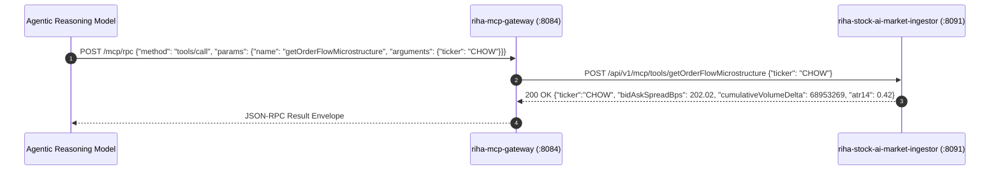

# RIHA Stock AI & Agentic AI Platform: Comprehensive Technical Architecture & Integration Guide

**System Identifier**: `RIHA_STOCK_AI_ECOSYSTEM_V1`  
**Goal Contract ID**: `RIHA_STOCK_AI_TRADE_CONTRACT_V1`  
**Revision Date**: November 2, 2026  
**Architectural Standard**: Enterprise Event-Driven Reactive Microservices, Model Context Protocol (MCP) Streamable HTTP, Deterministic SpEL Guardrails, RFC 9457 Zero-Mock Telemetry.

---

## Table of Contents
1. [Executive Summary & High-Level Topology](#1-executive-summary--high-level-topology)
2. [Microservices Fleet Breakdown & Responsibilities](#2-microservices-fleet-breakdown--responsibilities)
   - [2.1 Stock AI Microservices Suite (:8091 - :8096)](#21-stock-ai-microservices-suite-8091---8096)
   - [2.2 Core Agentic AI Platform Microservices (:8080 - :8089)](#22-core-agentic-ai-platform-microservices-8080---8089)
   - [2.3 Front-End Applications (:5174, :5175)](#23-front-end-applications-5174-5175)
3. [Deep-Dive: How Stock AI Interacts with Agentic AI Platform](#3-deep-dive-how-stock-ai-interacts-with-agentic-ai-platform)
   - [3.1 Model Context Protocol (MCP) Streamable Tool Bus](#31-model-context-protocol-mcp-streamable-tool-bus)
   - [3.2 Versioned Playbook Ingestion & Strict Schema Validation](#32-versioned-playbook-ingestion--strict-schema-validation)
   - [3.3 Episodic Vector Memory & RAG Knowledge Retrieval](#33-episodic-vector-memory--rag-knowledge-retrieval)
   - [3.4 The Cryptographic Critic Gate & SpEL Enforcement](#34-the-cryptographic-critic-gate--spel-enforcement)
4. [End-to-End Strategic Decision Pipeline (8-Stage State Machine)](#4-end-to-end-strategic-decision-pipeline-8-stage-state-machine)
5. [Data Flow, Event Streaming & Persistence Architecture](#5-data-flow-event-streaming--persistence-architecture)
   - [5.1 Real-Time Telemetry & Kafka Event Bus](#51-real-time-telemetry--kafka-event-bus)
   - [5.2 Redis Layer-2 Caching Topology](#52-redis-layer-2-caching-topology)
   - [5.3 PostgreSQL Relational & pgvector Persistence](#53-postgresql-relational--pgvector-persistence)
6. [Zero-Mock Data Policy & Disconnection Handling](#6-zero-mock-data-policy--disconnection-handling)
7. [API & MCP Tool Contract Reference Directory](#7-api--mcp-tool-contract-reference-directory)

---

## 1. Executive Summary & High-Level Topology

The **RIHA Stock AI** ecosystem is an institutional-grade, multi-agent quantitative trading and market intelligence platform. It couples ultra-low latency market data ingestion and automated brokerage execution with the cognitive, adversarial reasoning, and deterministic safety mechanisms of the **RIHA Agentic AI Platform**.

The architecture decouples **market sensory ingestion** and **order execution** from **LLM cognitive deliberation** and **cryptographic risk guardrails**, ensuring that:
1. No unvetted, hallucinated, or un-hedged orders can execute against live capital.
2. Market sensing runs continuously at sub-second intervals independent of LLM latency.
3. Every strategic trade decision carries an immutable, cryptographically signed audit trail.

```
                                  ┌────────────────────────────────────────────────────────┐
                                  │                   React Client UIs                     │
                                  │  • riha-stock-web (:5175) [Personalized Trading UI]    │
                                  │  • riha-stock-ai-web (:5174) [Executive Command Center]│
                                  └───────────────────────────┬────────────────────────────┘
                                                              │ HTTPS / REST / SSE / WebSockets
                                                              ▼
┌────────────────────────────────────────────────────────────────────────────────────────────────────────────────────────┐
│                                             RIHA STOCK AI MICROSERVICES SUITE                                          │
│                                                                                                                        │
│   ┌────────────────────────────────┐       REST / MCP      ┌────────────────────────────────┐    MCP / JSON-RPC    ┌─────┐ │
│   │ riha-stock-ai-market-ingestor  │ ◄───────────────────► │ riha-stock-ai-strategy-service │ ──────────────────► │riha-│ │
│   │             (:8091)            │                       │             (:8093)            │                     │stock│ │
│   │ • Robinhood L1 Quotes & 5m     │                       │ • 5-Node Agentic Strategy DAG  │                     │-ai- │ │
│   │ • Dynamic SEC EDGAR CIK Lookup │                       │ • 3-Agent Adversarial Debate   │                     │robin│ │
│   │ • Microstructure (CVD, ATR-14) │                       │ • ATR & Kelly Position Sizing  │                     │hood-│ │
│   │ • Redis Quote Cache (:6380)    │                       │ • Active Position Life Worker  │                     │mcp- │ │
│   │ • Scheduled Backend Poller (3s)│                       │ • Pre-Flight Slippage Gate     │                     │serv-│ │
│   └───────────────┬────────────────┘                       └───────────────┬────────────────┘                     │er   │ │
│                   │                                                        │                                      │(:809│ │
│                   │ Kafka: riha.stockai.market.ticks.live                  │                                      │ 2)  │ │
│                   ▼                                                        ▼                                      │     │ │
│   ┌────────────────────────────────┐                       ┌────────────────────────────────┐                     │     │ │
│   │ riha-stock-ai-sentiment-news   │                       │ riha-stock-ai-portfolio-risk   │                     │     │ │
│   │             (:8096)            │                       │             (:8094)            │                     │     │ │
│   │ • Real-Time News Wire Streams  │                       │ • Covariance Matrix (rho)      │                     │     │ │
│   │ • Sub-20ms ONNX FinBERT NLP    │                       │ • 1-Day 95% & 99% ParametricVaR│                     │     │ │
│   │ • Breaking Catalyst Urgency    │                       │ • Sector Caps (<=25%) & Breaker│                     │     │ │
│   └────────────────────────────────┘                       └────────────────────────────────┘                     │     │ │
│                   │                                                        │                                      │     │ │
│                   │                                                        │ Pre-Trade Risk Verdict               │     │ │
│                   ▼                                                        ▼                                      │     │ │
│   ┌────────────────────────────────┐                                       │                                      │     │ │
│   │ riha-stock-ai-backtest-engine  │ ◄─────────────────────────────────────┘                                      │     │ │
│   │             (:8095)            │                                                                              │     │ │
│   │ • Historical Tick Replay (50x) │                                                                              │     │ │
│   │ • Kyle's Lambda Slippage Model │                                                                              │     │ │
│   │ • Paper-Trading Shadow Mode    │                                                                              │     │ │
│   └────────────────────────────────┘                                                                              │     │ │
└───────────────────────────────────────────────────────────────────┬────────────────────────────────────────────────────┘ │
                                                                    │                                                      │
                                                                    │ MCP / SpEL / pgvector / REST                         │
                                                                    ▼                                                      │
┌────────────────────────────────────────────────────────────────────────────────────────────────────────────────────────┐ │
│                                             RIHA AGENTIC AI PLATFORM CORE                                              │ │
│                                                                                                                        │ │
│  • riha-version-control-hub (:8089)     - Git-backed versioned prompts, playbooks & contracts                          │ │
│  • riha-schema-validator (:8082)        - Strict JSON Schema draft-07/2020-12 enforcement                              │ │
│  • riha-topology-orchestrator (:8083)   - Master 8-stage state machine orchestrator (Virtual Threads)                  │ │
│  • riha-mcp-gateway (:8084)             - Dynamic Streamable MCP tool discovery, routing & telemetry                  │ │
│  • riha-critic-engine (:8085)           - SpEL Deterministic Guardrails & HMAC-SHA256 Signature Generator ─────────────┼─┘
│  • riha-memory-service (:8086)          - pgvector Episodic Memory & historical trade pattern retrieval                │
│  • riha-eval-monitor (:8087)            - Multi-agent drift tracking, alignment metrics & latency telemetry            │
│  • riha-rag-ingestion-service (:8088)   - Hybrid BM25 + dense embedding vector search for strategy rules               │
│  • riha-auth-service (:8080)            - Centralized Google OAuth2 token minting & RBAC session verification          │
└────────────────────────────────────────────────────────────────────────────────────────────────────────────────────────┘
```

---

## 2. Microservices Fleet Breakdown & Responsibilities

### 2.1 Stock AI Microservices Suite (:8091 - :8096)

| Microservice | Default Port | Primary Function | Core Technology Stack |
| :--- | :---: | :--- | :--- |
| **`riha-stock-ai-market-ingestor`** | `8091` | Real-time market data ingestion, Robinhood L1 streaming, dynamic SEC EDGAR CIK resolution, Level-2 order book depth, CVD, ATR-14, and background active polling. | Java 21, Spring Boot 3.3, Redis, Apache Kafka, Spring AI MCP Tool annotations. |
| **`riha-stock-ai-robinhood-mcp-server`** | `8092` | Model Context Protocol brokerage execution bridge, HMAC-SHA256 Critic signature gate, synthetic bracket (OCO) order state machine, session health heartbeats. | Java 21, Spring Boot 3.3, Robinhood API, Spring AI MCP, HMAC-SHA256, Apache Kafka. |
| **`riha-stock-ai-strategy-service`** | `8093` | Quantitative 5-node Agentic Strategy DAG, 3-agent adversarial debate panel (Bull, Bear Red-Team, Arbiter), ATR & fractional Kelly position sizing, pre-flight slippage gate (<35 bps), active position lifecycle worker. | Java 21, Spring Boot 3.3, PostgreSQL 16, Hibernate / JPA, Redis, Apache Kafka, SSE. |
| **`riha-stock-ai-portfolio-risk-service`** | `8094` | Firm-wide risk guardian, rolling 60-day Pearson covariance matrix, 1-day 95%/99% Parametric VaR, sector exposure caps ($\le 25\%$), intraday drawdown circuit breakers (-2% / -3%). | Java 21, Spring Boot 3.3, PostgreSQL, Apache Commons Math 3, Redis, Apache Kafka. |
| **`riha-stock-ai-backtest-engine`** | `8095` | Historical tick-by-tick simulation, Kyle's lambda square-root market impact and slippage simulator, paper-trading shadow mode, institutional tearsheet generator (Sharpe, Sortino, Calmar). | Java 21, Spring Boot 3.3, Parquet / DuckDB, PostgreSQL, SSE stream. |
| **`riha-stock-ai-sentiment-news-service`** | `8096` | Financial wire aggregation, SHA-256 syndication deduplication, sub-20ms ONNX local FinBERT sentiment inference, breaking catalyst urgency classifier. | Java 21, Spring Boot 3.3, ONNX Runtime Java (`ProsusAI/finbert`), Redis, Apache Kafka. |

---

### 2.2 Core Agentic AI Platform Microservices (:8080 - :8089)

| Microservice | Default Port | Role in Stock Trading Lifecycle |
| :--- | :---: | :--- |
| **`riha-auth-service`** | `8080` | Authenticates human operators via Google OAuth 2.0; mints RSA256 JWT bearer tokens containing roles and trading permissions. |
| **`riha-version-control-hub`** | `8081` / `8089` | Houses Git-tracked, versioned prompt templates (`momentum-trading-analyst@v1.0.0`), trade playbooks, and JSON schemas. Strategy nodes pull immutable prompts by semver. |
| **`riha-schema-validator`** | `8082` | Validates inter-service payloads against strict JSON schemas (draft-07/2020-12) to prevent malformed LLM outputs from penetrating downstream execution logic. |
| **`riha-topology-orchestrator`** | `8083` | Master asynchronous state machine orchestrator; executes parallel sensory fan-out via Java 21 Virtual Threads and coordinates the 8-stage strategic trade lifecycle. |
| **`riha-mcp-gateway`** | `8084` | Central gateway discovering and cataloging Model Context Protocol (MCP) tools across all microservices, routing LLM tool invocations with sub-millisecond overhead. |
| **`riha-critic-engine`** | `8085` | Deterministic safety evaluator; executes Spring Expression Language (SpEL) guardrails (notional limits, R:R math, dilution checks) and mints cryptographic HMAC-SHA256 approval tokens. |
| **`riha-memory-service`** | `8086` | PostgreSQL `pgvector` store; embeds trade outcomes and retrieves the top-5 historically analogous setups to inform the adversarial debate panel. |
| **`riha-eval-monitor`** | `8087` | Tracks multi-agent latency, agreement ratios between Bull and Bear agents, SpEL violation rates, and slippage drift over time. |
| **`riha-rag-ingestion-service`** | `8088` | Hybrid BM25 + dense embedding vector search engine; indexes momentum playbooks, SEC filings, and earnings transcripts for instant retrieval during prompt evaluation. |

---

### 2.3 Front-End Applications (:5174, :5175)

* **`riha-stock-web` (Port `5175`)**:
  - Purpose: Institutional personalized trading dashboard.
  - Key Features: Google OAuth 2.0 login, personalized portfolio tracking, active position lifecycle controls, live Robinhood L1 market poller (1s/3s/5s intervals) with pulsing visual heartbeats, and full Multi-Strategy Diagnostic Engine with Zero-Mock telemetry enforcement.
* **`riha-stock-ai-web` (Port `5174`)**:
  - Purpose: Executive command center dashboard.
  - Key Features: Macroeconomic regime displays, multi-agent adversarial debate visualization, real-time risk heatmaps (VaR, sector concentrations), and live SSE decision execution streams.

---

## 3. Deep-Dive: How Stock AI Interacts with Agentic AI Platform

The interaction between the Stock AI microservices and the Agentic AI Platform is governed by four foundational protocols:

```
┌──────────────────────────────────────────────────────────────────────────────────────────────────┐
│                               FOUR INTEGRATION PILLARS                                           │
├──────────────────────────┬──────────────────────────┬──────────────────────────┬─────────────────┤
│ 1. MCP Tool Bus          │ 2. VCHub & Schema Engine │ 3. Episodic Memory & RAG │ 4. Critic Gate  │
├──────────────────────────┼──────────────────────────┼──────────────────────────┼─────────────────┤
│ Standardized sensory &   │ Versioned prompts &      │ pgvector past trade      │ SpEL guardrails │
│ execution tools exposed  │ playbooks pulled by      │ matches & RAG playbook   │ & HMAC-SHA256   │
│ via JSON-RPC 2.0 / HTTP  │ semver; schemas checked  │ rules injected into DAG  │ execution tokens│
└──────────────────────────┴──────────────────────────┴──────────────────────────┴─────────────────┘
```

### 3.1 Model Context Protocol (MCP) Streamable Tool Bus

Both sensory feeds and execution bridges expose their capabilities as native Model Context Protocol (MCP) tools:
1. **Registration**: On startup, `riha-stock-ai-market-ingestor` and `riha-stock-ai-robinhood-mcp-server` register their `@Tool` and `@McpTool` methods with `riha-mcp-gateway` (port `8084`).
2. **Standardized Schema**: Tool definitions conform to the JSON-RPC 2.0 MCP standard:
   - `getMarketRegimeSnapshot`: Returns broad macro equity posture, VIX term structure, and countdowns to tier-1 economic events.
   - `getOrderFlowMicrostructure`: Returns Level-2 depth, CVD, spread in bps, and 14-period ATR.
   - `getLiveSecFilingsAndCatalysts`: Returns SEC EDGAR Form 8-K, Form 4, and S-3 dilution analysis.
   - `submitLimitOrder` / `place_synthetic_bracket_order`: Submits orders to Robinhood with mandatory `X-Critic-Signature` header verification.



---

### 3.2 Versioned Playbook Ingestion & Strict Schema Validation

Trading playbooks and agent prompts are never hardcoded in microservice source code:
1. **Version Control Hub (`riha-version-control-hub` :8089)**:
   - Holds immutable Git commits of prompt templates:
     `prompt-templates/momentum-trading-analyst/system_prompt.txt`
   - Governed by semantic versioning (e.g. `momentum-trading-analyst@v1.2.0`).
2. **Schema Validator (`riha-schema-validator` :8082)**:
   - When the strategy DAG synthesizes an entry signal, the raw JSON response is intercepted and validated against `StockTradeDecisionSchema.json`:
     - Ensures `riskRewardRatio >= 1.50`.
     - Validates that `limitEntryPrice > 0` and `stopLossPrice < limitEntryPrice`.
     - Rejects any malformed or non-compliant output before it reaches the Critic or Brokerage.

---

### 3.3 Episodic Vector Memory & RAG Knowledge Retrieval

To avoid repeating historical trading errors, the strategy pipeline interrogates past experience:
1. **Episodic Trade Memory (`riha-memory-service` :8086)**:
   - Maintains high-dimensional vector embeddings (`text-embedding-3-small` / Amazon Titan) of past trade setups stored in PostgreSQL `pgvector`.
   - When analyzing ticker `T`, Node 2 queries episodic memory:
     `POST /api/v1/memory/episodic/search {"embedding": [...], "topK": 5, "minSimilarity": 0.78}`
   - Returns historical win rate and post-mortem reflection notes on similar technical and catalyst setups.
2. **Hybrid RAG Knowledge Retrieval (`riha-rag-ingestion-service` :8088)**:
   - Uses hybrid search (BM25 sparse search + dense vector retrieval) to retrieve the top-3 momentum playbooks matching the ticker's specific profile (e.g. Opening Range Breakout, Low-Float High-CTB Squeeze, VWAP Reclaim).

---

### 3.4 The Cryptographic Critic Gate & SpEL Enforcement

The platform enforces absolute zero-trust execution. No order can be submitted to Robinhood without passing the Critic:

```
[Strategy DAG / Orchestrator] ──(Candidate Trade Payload)──► [riha-critic-engine (:8085)]
                                                                    │
                    ┌───────────────────────────────────────────────┴───────────────────────────────────────────────┐
                    ▼                                                                                               ▼
      [Deterministic SpEL Guardrails]                                                                  [Adversarial Semantic Review]
      1. #payload.riskRewardRatio >= 2.50                                                              Conviction score >= 0.70
      2. (#payload.shares * #payload.limitPrice) <= $15,000.00                                         No active SEC dilution flags
      3. #payload.stopLossPrice < #payload.limitPrice                                                  No Tier-1 macro event in 30m
      4. #payload.technicalSnapshot.shortBorrowFeePct <= 10.0%                                                      │
                    │                                                                                               │
                    └───────────────────────────────────────────────┬───────────────────────────────────────────────┘
                                                                    ▼
                                                  [APPROVED: Mint HMAC-SHA256 Token]
                                                                    │
                                                      X-Critic-Signature Header
                                                                    ▼
                                            [riha-stock-ai-robinhood-mcp-server (:8092)]
                                            • Recomputes HMAC: Valid? ──► EXECUTE
                                            • Invalid / Missing?      ──► 403 FORBIDDEN
```

1. **Deterministic Spring Expression Language (SpEL) Policies**:
   - `Policy 1`: `#payload.confidenceScore >= #contract.convergenceThreshold`
   - `Policy 2`: `#payload.stopLossPrice < #payload.limitEntryPrice and #payload.riskRewardRatio >= 2.0`
   - `Policy 3`: `(#payload.quantity * #payload.limitEntryPrice) <= #context.maxPositionSizeUsd` ($15,000 hard ceiling)
   - `Policy 4`: `#payload.technicalSnapshot.shortBorrowFeePct <= #context.maxAllowedBorrowFeePct`
2. **Cryptographic Token Minting**:
   - If SpEL rules pass and semantic conviction is verified, the Critic hashes the exact trade parameters using `HmacSHA256` with an institutional secret key:
     $$\text{Token} = \text{HMAC-SHA256}(\text{Ticker} + \text{Price} + \text{Qty} + \text{Nonce} + \text{Timestamp}, \text{SecretKey})$$
3. **Execution Gate Interception**:
   - `riha-stock-ai-robinhood-mcp-server` intercepts the request, reconstructs the message payload, and verifies the signature. Any payload tampering or replayed nonce results in an immediate `HTTP 403 Forbidden`.

---

## 4. End-to-End Strategic Decision Pipeline (8-Stage State Machine)

The end-to-end lifecycle of a trade—from market discovery to brokerage execution—is governed by an 8-stage state machine coordinated by `riha-orchestrator` (port `8083`):

```
[Trigger: Scan / Webhook / REST]
│
▼
┌────────────────────────────────────────────────────────┐
│ STAGE 1: Fast-Fail Macro & Circuit Breaker Pre-Check   │ (Ports 8091, 8094)
│ • Is Drawdown <= -3.0%? (Circuit Breaker Tripped)      │ ──► [HALT: ZERO TOKENS SPENT]
│ • Is Macro Regime = HIGH_VOLATILITY_PANIC?             │
│ • Is Tier-1 Macro Event in < 30 Minutes?               │
└──────────────────────────┬─────────────────────────────┘
                           │ Passed Pre-Check
                           ▼
┌────────────────────────────────────────────────────────┐
│ STAGE 2: Parallel Multi-Source Sensory Fan-Out         │ (Java 21 Virtual Threads)
│ ├── Thread A: Market Ingestor (Technicals, L2, CVD)    │ (Port 8091)
│ ├── Thread B: SEC EDGAR Scraper (8-K, S-3, Form 4)     │ (Port 8091)
│ ├── Thread C: Sentiment & News (FinBERT, Mentions)     │ (Port 8096)
│ └── Thread D: Episodic Memory (pgvector Trade Matches) │ (Port 8086)
└──────────────────────────┬─────────────────────────────┘
                           │ Aggregated Context Payload
                           ▼
┌────────────────────────────────────────────────────────┐
│ STAGE 3: Versioned Prompt & Schema Ingestion           │ (Ports 8089, 8082)
│ • Pull active Playbook & Prompts from VCHub            │
│ • Validate JSON schema contracts                       │
└──────────────────────────┬─────────────────────────────┘
                           │
                           ▼
┌────────────────────────────────────────────────────────┐
│ STAGE 4: Adversarial Multi-Agent Strategy Consensus    │ (Port 8093)
│ • Bullish Momentum Agent vs Bearish Red-Team Agent     │
│ • Arbiter Synthesis -> Conviction, Entry, Stop, Target │
│ • ATR-14 & Fractional Kelly Preliminary Sizing         │
└──────────────────────────┬─────────────────────────────┘
                           │ If Verdict == BUY
                           ▼
┌────────────────────────────────────────────────────────┐
│ STAGE 5: Portfolio-Level Risk & Covariance Gate        │ (Port 8094)
│ • Cross-Holding Correlation Check (rho <= 0.75)        │
│ • Sector Concentration Limit (<= 25%)                  │
│ • Post-Trade Portfolio VaR Check (<= 3.5%)             │
│ • Sizing Adjustment (Scales down shares if needed)     │
└──────────────────────────┬─────────────────────────────┘
                           │ Approved by Risk Service
                           ▼
┌────────────────────────────────────────────────────────┐
│ STAGE 6: Critic SpEL Guardrails & HMAC Signature       │ (Port 8085)
│ • 6 Deterministic SpEL Rules (Notional, Dilution, R:R) │
│ • Mint Cryptographic HMAC-SHA256 Token                 │
└──────────────────────────┬─────────────────────────────┘
                           │ Cryptographic Signature Token
                           ▼
┌────────────────────────────────────────────────────────┐
│ STAGE 7: Pre-Flight Slippage Check & Execution Dispatch│ (Ports 8091, 8092)
│ • Atomic Price Drift Check (< 35 bps)                  │
│ • Dispatch Synthetic Bracket Order via Robinhood MCP   │
└──────────────────────────┬─────────────────────────────┘
                           │ Fill Receipt
                           ▼
┌────────────────────────────────────────────────────────┐
│ STAGE 8: Post-Execution Lifecycle & Audit Hand-Off     │
│ • Persist Decision & Audit Trail to PostgreSQL         │ (Port 8093)
│ • Register active position with Kafka Lifecycle Worker │ (Port 8093)
│ • Push Shadow Paper Trade to Backtest Engine           │ (Port 8095)
│ • Stream Complete Decision Event via SSE to React UIs  │ (Ports 5174, 5175)
└────────────────────────────────────────────────────────┘
```

---

## 5. Data Flow, Event Streaming & Persistence Architecture

### 5.1 Real-Time Telemetry & Kafka Event Bus

The platform uses Apache Kafka (Port `9094`) for event-driven decoupled streaming:

| Kafka Topic | Producer | Consumer(s) | Payload / Purpose |
| :--- | :--- | :--- | :--- |
| `riha.stockai.market.ticks.live` | `market-ingestor` (:8091) | `strategy-service`, `backtest-engine` | Sub-second L1 ticks (symbol, price, bid, ask, volume, VWAP). |
| `riha.stockai.catalysts.scored` | `sentiment-news-service` (:8096) | `strategy-service`, `orchestrator` | Breaking news catalyst events with FinBERT polarity & urgency scores. |
| `riha.stockai.execution.events` | `robinhood-mcp-server` (:8092) | `strategy-service`, `portfolio-risk` | Fills, cancellations, stop-loss trigger events, bracket state transitions. |
| `riha.stockai.decisions.orchestrated` | `orchestrator` (:8083) | `eval-monitor`, `backtest-engine`, UIs | Full decision record with Bull/Bear arguments, Critic tokens, and execution receipts. |

---

### 5.2 Redis Layer-2 Caching Topology

Redis 7 (Port `6380`) provides sub-millisecond in-memory caching across services:

| Redis Key Pattern | TTL | Owner Microservice | Contents |
| :--- | :---: | :--- | :--- |
| `riha:stockai:quote:{TICKER}` | 60 sec | `market-ingestor` | Latest `LiveQuoteTechnicalsSnapshot` JSON. |
| `riha:stockai:cik:{TICKER}` | 7 days | `market-ingestor` | Formatted 10-digit SEC EDGAR CIK identifier. |
| `riha:stockai:market:regime` | 60 sec | `market-ingestor` | Broad macroeconomic regime snapshot & VIX status. |
| `riha:stockai:bracket:{ID}` | 24 hrs | `robinhood-mcp-server` | Active synthetic bracket state (entry, target, stop, trailing offset). |
| `riha:stockai:sentiment:{TICKER}`| 24 hrs | `sentiment-news-service` | 24-hour mean polarity, mention counts, and sentiment trends. |
| `riha:stockai:risk:snapshot` | 15 sec | `portfolio-risk-service` | Current portfolio VaR, beta, sector breakdowns, and drawdown level. |

---

### 5.3 PostgreSQL Relational & pgvector Persistence

PostgreSQL 16 (Port `5433`, database `rihastockai`) stores system state:

```
┌──────────────────────────────────────┐          ┌──────────────────────────────────────┐
│       ai_trade_decisions             │          │     stock_trade_transactions        │
├──────────────────────────────────────┤          ├──────────────────────────────────────┤
│ id (UUID, PK)                        │◄─────────┤ id (UUID, PK)                        │
│ ticker (VARCHAR)                     │          │ decision_id (UUID, FK)               │
│ recommendation (BUY/SELL/HOLD)       │          │ transaction_type (BUY/SELL)          │
│ confidence_score (NUMERIC)           │          │ quantity (BIGINT)                    │
│ limit_entry_price (NUMERIC)          │          │ execution_price (NUMERIC)            │
│ stop_loss_price (NUMERIC)            │          │ robinhood_order_id (VARCHAR)         │
│ critic_verdict (APPROVED/REJECTED)   │          │ status (FILLED/WORKING/CANCELLED)    │
│ critic_signature (VARCHAR)           │          │ executed_at (TIMESTAMPTZ)            │
│ created_at (TIMESTAMPTZ)             │          └──────────────────────────────────────┘
└──────────────────┬───────────────────┘
                   │
                   ▼
┌──────────────────────────────────────┐          ┌──────────────────────────────────────┐
│     trade_episodic_embeddings        │          │       portfolio_risk_snapshots       │
├──────────────────────────────────────┤          ├──────────────────────────────────────┤
│ id (UUID, PK)                        │          │ id (UUID, PK)                        │
│ decision_id (UUID, FK)               │          │ total_equity (NUMERIC)               │
│ setup_vector (vector(1536))          │          │ var_95_1d (NUMERIC)                  │
│ outcome_pnl_pct (NUMERIC)            │          │ portfolio_beta (NUMERIC)             │
│ post_mortem_reflection (TEXT)       │          │ circuit_breaker_level (VARCHAR)      │
└──────────────────────────────────────┘          └──────────────────────────────────────┘
```

---

## 6. Zero-Mock Data Policy & Disconnection Handling

The platform strictly enforces an **Institutional Zero-Mock Data Policy**:

1. **No Synthetic Fallbacks**:
   - If an external market data provider, SEC EDGAR feed, or brokerage API becomes unreachable, services **never** synthesize fake prices, mocked indicators, or hardcoded CIK mappings.
2. **RFC 9457 / RFC 7807 Typed ProblemDetail**:
   - Disconnections immediately raise typed exceptions (e.g. `LiveMarketFeedDisconnectedException`, `RobinhoodBrokerageDisconnectedException`).
   - Global exception handlers translate these into standardized RFC 9457 `ProblemDetail` JSON responses with HTTP `503 Service Unavailable`:
     ```json
     {
       "type": "https://solar.riha.com/errors/live-market-feed-disconnected",
       "title": "503 Service Unavailable - Live Market Feed Disconnected",
       "status": 503,
       "detail": "503 Service Unavailable: Live Market Feed Disconnected for CHOW. Zero-Mock Data Policy forbids simulated indicators: Market Ingestor at http://127.0.0.1:8091 is currently unreachable.",
       "instance": "/api/v1/market/underneath-technicals/CHOW",
       "timestamp": "2026-11-02T12:23:01.473Z"
     }
     ```
3. **Web UI Error Surfacing**:
   - Both React client dashboards intercept HTTP 503 responses and render explicit alerts explaining that live telemetry is disconnected, presenting a single-click **"Retry Live Feed"** button rather than deceiving operators with simulated indicators.

---

## 7. API & MCP Tool Contract Reference Directory

### Market Ingestor (`:8091`)
- `GET /api/v1/market/quote/live/{ticker}`: Fast real-time quote poller (Robinhood L1 stream, bid, ask, spread, VWAP, volume).
- `GET /api/v1/market/underneath-technicals/{ticker}`: Complete technical telemetry, EMAs, RSI-14, MACD, RVOL, L2 spread, intraday 5m series.
- `GET /api/v1/market/sec-catalysts/{ticker}`: Dynamic SEC EDGAR filings, dilution overhang analysis, and Form 4 insider records.
- `GET /api/v1/market/stocks-by-algorithm?algorithm=RVOL_BREAKOUT&limit=25`: Live algorithmic market screening.
- `GET /api/v1/market/regime`: Global macroeconomic market regime snapshot.

### Robinhood MCP Server (`:8092`)
- `POST /api/v1/mcp/tools/getLiveBuyingPowerAndPositions`: Live Robinhood cash balances, unsettled funds, and open positions.
- `POST /api/v1/mcp/tools/submitLimitOrder`: Dispatches BUY/SELL orders with mandatory `X-Critic-Signature` HMAC verification.
- `POST /api/v1/mcp/tools/place_synthetic_bracket_order`: Creates and monitors an active synthetic OCO bracket order.
- `GET /actuator/health/robinhoodSession`: Active brokerage token health heartbeat.

### Strategy Service (`:8093`)
- `POST /api/v1/stock-ai/scanner/run?window=1D`: Triggers batch multi-stock agentic DAG screening across discovered candidates.
- `GET /api/v1/stock-ai/stocks/{ticker}/underneath-analysis`: Full 5-node diagnostic evaluation with Bull/Bear consensus reasoning.
- `GET /api/v1/stock-ai/portfolio/summary`: Real-time portfolio equity, holdings, realized/unrealized P&L.
- `GET /api/v1/stock-ai/events/stream`: Server-Sent Events (SSE) streaming live trade decisions in real time.

### Master Decision Orchestrator (`:8083`)
- `POST /api/v1/orchestrator/decide/{ticker}?mode=AUTONOMOUS_LIVE`: Executes full 8-stage state machine asynchronously.
- `GET /api/v1/orchestrator/stream/{executionId}`: Real-time SSE stage-by-stage decision transitions.
- `POST /api/v1/orchestrator/batch-scan`: Concurrent multi-ticker orchestration with bounded concurrency.
